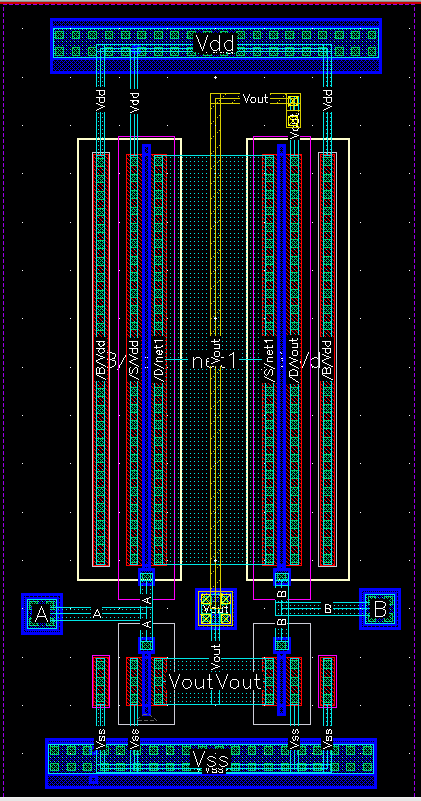

# PSI5723: Intro to CMOS VLSI Systems Design

This repository contains solutions to practical problem sets from the course [**PSI5723: Intro to CMOS VLSI Systems Design**](https://uspdigital.usp.br/janus/componente/disciplinasOferecidasInicial.jsf?action=3&sgldis=PSI5723) offered at the University of São Paulo using [Cadence Virtuoso](https://www.cadence.com/en_US/home/tools/custom-ic-analog-rf-design/layout-design/virtuoso-layout-suite.html) and a library of TSMC components for layout.

The problem set statements are provided in the **virtuoso_pset.pdf** file.

